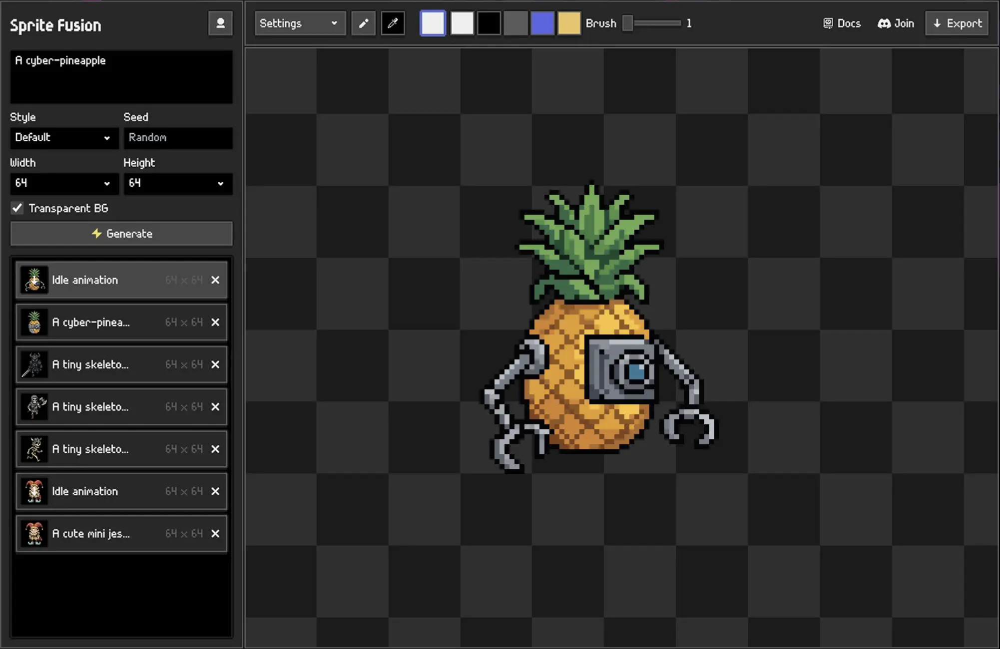

# Sprite Fusion for Godot

[Sprite Fusion](https://www.spritefusion.com/pixel-art-generator) is a professional pixel-art sprites and animations generator. This is the native plugin for the Godot editor.

## Install

1. Install the plugin from the Godot Asset Library, or download the latest release from GitHub.
2. Copy `addons/spritefusion` into your Godot project if installing manually.
3. In Godot, open `Project > Project Settings > Plugins`.
4. Enable `Sprite Fusion`.
5. Open the Sprite Fusion dock and connect your account.

## Requirements

- Godot 4.x
- Sprite Fusion account

## Usage

1. Click `Connect` in the Sprite Fusion dock.
2. Approve the device code in your browser.
3. Enter a prompt and click `Generate`.
4. Select a generated image, enter an animation prompt, and click `Animate`.

Generated assets are written to `res://spritefusion/generated`.

## Useful links

- Website: https://www.spritefusion.com
- Docs: https://www.spritefusion.com/docs/pixel-art-generator/integrations/godot

## License

This plugin is licensed under MIT.
